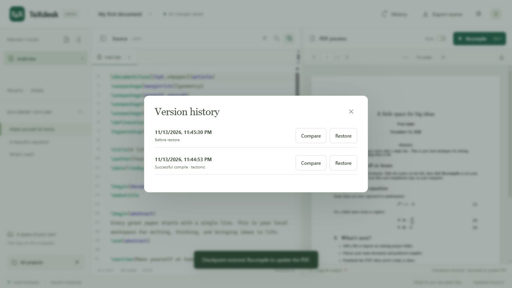

# mini_LaTeX_Editor

mini_LaTeX_Editor is a local LaTeX editor with an Overleaf-style workspace. Edit your source, compile it with a TeX engine installed on your computer, and preview the PDF beside the editor.

[Quick start](#quick-start) · [Compiler setup](#install-a-compiler) · [First PDF](#compile-your-first-pdf) · [Troubleshooting](#troubleshooting)

- Edit LaTeX with syntax highlighting, autocomplete, search and replace, and a document outline.
- Import a project folder or ZIP, add files, and export the source or PDF.
- Jump to compiler errors and navigate between the source and PDF with SyncTeX.
- Compare or restore local checkpoints. A successful build saves a checkpoint, and a restore first saves the current files for recovery.

## Quick start

You need **Node.js 22.13 or newer**, npm, and **one** supported LaTeX compiler. Node.js 24 LTS is a good choice. Use Git to clone the repository or select **Code → Download ZIP** on GitHub and extract it. [Download Node.js](https://nodejs.org/en/download)

Clone the project from its [GitHub repository](https://github.com/Ali-Kazzazi/mini_LaTeX_Editor).

~~~sh
git clone https://github.com/Ali-Kazzazi/mini_LaTeX_Editor.git
cd mini_LaTeX_Editor
~~~

If you downloaded a ZIP, open a terminal in the extracted folder that contains `package.json`. Install the app dependencies from that folder or your clone.

~~~sh
npm ci
~~~

**Windows x64** users can install the project's portable Tectonic compiler with the following command. If you already have a working LaTeX engine, proceed to the build commands.

~~~powershell
npm run setup:compiler
~~~

On **macOS or Linux**, [install a compiler](#install-a-compiler) separately. Then build and start mini_LaTeX_Editor from the repository root.

~~~sh
npm run build
npm start
~~~

Open **[http://127.0.0.1:4030](http://127.0.0.1:4030)**. Keep the terminal running while you use the app. Press **Ctrl+C** in that terminal to stop it.

On Windows you can also double-click **[start-texdesk.cmd](start-texdesk.cmd)**. It installs npm dependencies or builds the frontend if those files are missing. Install a compiler separately before the first compile.

## Choose an engine

MiKTeX, TeX Live, and MacTeX are distributions that install LaTeX commands and packages. mini_LaTeX_Editor's compiler menu lists the commands it runs. To typeset a LaTeX document with pdfTeX, choose **`pdflatex`**. That command loads the LaTeX format for the pdfTeX engine.

| mini_LaTeX_Editor setting | Where to get it | When to choose it |
| --- | --- | --- |
| `tectonic` | Portable Windows setup script or an upstream Tectonic release | A small initial install with on-demand packages, Unicode and system-font support, and built-in BibTeX handling |
| `pdflatex` | MiKTeX, TeX Live, or MacTeX | Standard LaTeX documents and templates that specify pdfLaTeX |
| `xelatex` | MiKTeX, TeX Live, or MacTeX | XeLaTeX templates, multilingual text, or documents using `fontspec` with installed fonts |
| `lualatex` | MiKTeX, TeX Live, or MacTeX | LuaLaTeX templates or documents that need LuaTeX features or `fontspec` |

Start with the compiler specified by your template. **Auto** picks the first available engine in this order: Tectonic, pdfLaTeX, XeLaTeX, LuaLaTeX. Choose an engine explicitly if several are installed and your document requires one. [LaTeX Project engine overview](https://www.latex-project.org/publications/2022-JAW-TUB-tb133wright-l3build.pdf)

## Install a compiler

### Tectonic

**Windows x64.** From the repository root after `npm ci`, run:

~~~powershell
npm run setup:compiler
.\.tools\tectonic.exe --version
~~~

The setup script downloads the official Windows x64 archive for **Tectonic 0.17.0**, checks its SHA-256, and extracts the executable to `.tools/tectonic.exe`. It also configures access to Windows system fonts. mini_LaTeX_Editor detects this copy directly. [Pinned release](https://github.com/tectonic-typesetting/tectonic/releases/tag/tectonic%400.17.0) · [Setup script](scripts/setup-compiler.mjs)

**Manual installation on Windows, macOS, or Linux.** Download an archive for your OS and CPU from the release page and extract it. On macOS or Linux, make the extracted binary executable with `chmod +x ./tectonic` if needed. Place its containing directory on `PATH` or set `TEXDESK_TECTONIC` to the absolute executable path. Confirm with `tectonic --version` when using `PATH`. [Tectonic releases](https://github.com/tectonic-typesetting/tectonic/releases) · [Official install guide](https://tectonic-typesetting.github.io/book/latest/installation/)

**Packages and offline use.** The first build may take longer while Tectonic downloads LaTeX support files. Later builds reuse its cache. To use that cache without requesting new packages, first compile successfully online, then enable **Use cached packages only (Tectonic)** in **Project settings**. A later build can still need an uncached file. Use **Retry with downloads** when offered to allow downloads for that build. The setting remains enabled. [Tectonic cache documentation](https://tectonic-typesetting.github.io/book/latest/getting-started/first-document.html)

### MiKTeX on Windows

1. Download and run the **Basic MiKTeX Installer**. A per-user installation works well for a local mini_LaTeX_Editor setup. [MiKTeX downloads](https://miktex.org/download) · [Windows installation guide](https://miktex.org/howto/install-miktex)
2. Open **MiKTeX Console → Updates**, check for updates, and install them. Install any packages your project needs from **Packages**. For unattended builds, use the Console to resolve missing packages before retrying in mini_LaTeX_Editor. [MiKTeX Console guide](https://miktex.org/howto/miktex-console)
3. Open a new PowerShell window. Run the version check for the engine you plan to use.

   ~~~powershell
   pdflatex --version
   xelatex --version
   lualatex --version
   ~~~

4. Start mini_LaTeX_Editor from that terminal and select **pdflatex**, **xelatex**, or **lualatex** in **Project settings → LaTeX compiler**.

If the compiler prints a missing-file error such as `File 'geometry.sty' not found`, install the package that provides that file. Package IDs and filenames can differ. For example, the `geometry` package can be installed from MiKTeX Console or with the following command in a per-user installation. [MiKTeX package commands](https://docs.miktex.org/manual/miktex-packages.html)

~~~powershell
miktex packages install geometry
~~~

### TeX Live on Windows and Linux

**Windows.** Download `install-tl-windows.exe` from the TeX Live network installer page, run it, and complete the installer. A full installation provides a broad package set. A smaller scheme may require installing additional packages. Open a fresh PowerShell window and check the executable you want, for example `pdflatex --version`. [TeX Live network installer](https://tug.org/texlive/acquire-netinstall.html) · [TeX Live installation manual](https://tug.org/texlive/doc/texlive-en/texlive-en.html)

**Debian and Ubuntu.** The distribution packages below provide the three LaTeX commands and common LaTeX packages. You can leave out the XeTeX or LuaTeX package if you only use pdfLaTeX. [Debian TeX package index](https://packages.debian.org/stable/tex/)

~~~sh
sudo apt update
sudo apt install texlive-latex-base texlive-latex-recommended texlive-xetex texlive-luatex
pdflatex --version
xelatex --version
lualatex --version
~~~

For other Linux distributions, use your package manager or the upstream TeX Live installer. Manage packages with the same tool that installed your TeX distribution. Use `tlmgr` for upstream TeX Live and `apt` for Debian or Ubuntu system packages. [TeX Live manual](https://tug.org/texlive/doc/texlive-en/texlive-en.html)

### MacTeX on macOS

Download and open the MacTeX `.pkg` installer, then follow its installation steps. Open a new Terminal window and check your chosen engine, for example `xelatex --version`. MacTeX exposes the TeX commands through `/Library/TeX/texbin`. If the terminal cannot find them, use the full executable path or add that directory to `PATH`. [MacTeX download](https://tug.org/mactex/mactex-download.html) · [MacTeX installation details](https://tug.org/mactex/What_Is_Installed.pdf)

### Connect the engine to mini_LaTeX_Editor

1. If you installed an engine or changed `PATH`, restart mini_LaTeX_Editor from a fresh terminal so its server sees the change.
2. In mini_LaTeX_Editor, open **Project settings → Refresh compilers**. The compiler list shows the version for each engine it can run.
3. Choose **LaTeX compiler**, set **Main document** to the file containing `\documentclass` and `\begin{document}`, and click **Save settings**.

If two distributions provide the same command, mini_LaTeX_Editor uses the one found first on the server's `PATH`. You can select a specific executable without changing your system `PATH`. Substitute its actual path in the example and start mini_LaTeX_Editor from the same terminal.

~~~powershell
$env:TEXDESK_PDFLATEX = 'C:\path\to\pdflatex.exe'
npm start
~~~

~~~sh
TEXDESK_XELATEX=/Library/TeX/texbin/xelatex npm start
~~~

| Variable | Purpose |
| --- | --- |
| `TEXDESK_TECTONIC` | Path to Tectonic, taking precedence over the portable copy |
| `TEXDESK_PDFLATEX` | Path to pdfLaTeX |
| `TEXDESK_XELATEX` | Path to XeLaTeX |
| `TEXDESK_LUALATEX` | Path to LuaLaTeX |
| `TEXDESK_DATA_DIR` | Local project storage directory. Defaults to `.data/` in the repository |
| `PORT` | Local HTTP port. Defaults to `4030` |

For a permanent port change in your checkout, edit the default in [server/index.mjs](server/index.mjs), then restart the server and open the URL printed in the terminal.

## Compile your first PDF

1. Open [mini_LaTeX_Editor](http://127.0.0.1:4030) and choose **New project** from the project menu, or use the starter project.
2. Open `main.tex` and replace the starter with this minimal document.

   ~~~latex
   \documentclass{article}
   \begin{document}
   Hello from \texttt{mini\_LaTeX\_Editor}!

   \[
     E = mc^2
   \]
   \end{document}
   ~~~

3. In **Project settings**, choose the installed engine and set **Main document** to `main.tex`.
4. Click **Recompile** or press **Ctrl+Enter** (**⌘+Enter** on macOS). The PDF opens in the preview. Use the preview's **Download PDF** button to save it.

You can also verify the toolchain independently. Save the example as `main.tex` in a separate folder, open a terminal there, and run **one** command for your installed engine. Each command writes `main.pdf` in that folder. If you installed Tectonic with mini_LaTeX_Editor's Windows script, replace `tectonic` with the full path to `.tools\tectonic.exe`.

~~~sh
tectonic main.tex
pdflatex -interaction=nonstopmode -halt-on-error main.tex
xelatex -interaction=nonstopmode -halt-on-error main.tex
lualatex -interaction=nonstopmode -halt-on-error main.tex
~~~

### Work with an existing project

Use **Import folder** or **Import ZIP** from the project menu to copy a project into mini_LaTeX_Editor. You can export a project ZIP from Overleaf and import it here. Keep all source, image, bibliography, and custom class files together, then select the main `.tex` file and the compiler the project expects. Relative paths in commands such as `\input{chapters/intro}` resolve from the project root.

- Turn on **Auto** to compile after edits. The editor saves source files automatically.
- Use **Logs & output** to read the compiler log. When mini_LaTeX_Editor can identify a project file and line, click the error to jump to the source. A failed build keeps the last successful PDF available.
- Use **Jump to PDF** in the editor toolbar or double-click a page in the preview. Recompile after editing to refresh SyncTeX locations.
- Use **History** to compare or restore one of the ten most recent checkpoints, including recovery checkpoints made before restores. Recompile after restoring to update the PDF.
- Use **Export source** to save a ZIP of the current project files.

## Troubleshooting

| Symptom | What to check |
| --- | --- |
| Compiler shows **Not found** | Run its `--version` check in the same terminal that starts mini_LaTeX_Editor. Confirm `PATH` or set the matching `TEXDESK_*` executable path. Restart the server and refresh compilers. |
| A class or package file is missing | Check the filename in **Logs & output**. For Tectonic, try a build with downloads enabled. For MiKTeX, install the package in MiKTeX Console. For TeX Live or MacTeX, install it using the package manager for that installation. For project-specific files, include them in the import. |
| `fontspec` reports an engine or font error | Select XeLaTeX, LuaLaTeX, or Tectonic as appropriate for the template. Install the font named by the document or use a font available on the machine. |
| LaTeX fails on an imported project | Check the main document, original compiler, required files, and paths. Try the minimal example to confirm the toolchain before debugging the template. |
| PDF is stale | Open the log and fix the first error. Then recompile. mini_LaTeX_Editor continues showing the last successful PDF after a failed build. |
| Port 4030 is in use | Stop the other server or choose a free port. In PowerShell, run `$env:PORT = '4031'` followed by `npm start`. Open the URL printed by the server. |
| PowerShell blocks `npm.ps1` | Use `npm.cmd` in place of `npm`, or run the commands from Command Prompt. |
| The browser still shows an older interface | Run `npm run build` from the repository root, then refresh the browser. |

Tectonic handles its own reruns and BibTeX. The other engines run two LaTeX passes. If your project needs a separate Biber, BibTeX, or MakeIndex step with those engines, use an external build workflow. mini_LaTeX_Editor invokes engines with shell escape disabled and is intended for single-user, local compilation.

## Project storage and backups

The server listens on the loopback interface. Source files, generated PDFs, logs, and checkpoints stay in local storage under `.data/projects/<project-id>/` by default. Restored sources live in a `.sources/` revision directory. Package installation can contact the compiler's package servers.

Back up the whole `.data/` directory to keep project settings, compiled output, and history. Use **Export source** for a portable ZIP of just the current project files and assets. Imports allow up to 500 files at a time, with a 15 MB limit per file and a 100 MB limit per project.

## Development

~~~sh
npm ci
npm run build
npm test
~~~

`npm run dev` builds the frontend once and starts the server in watch mode. After editing files in `src/`, run `npm run build` again and refresh the browser. `src/` holds the editor and PDF viewer, `server/` handles project storage and compilation, and `scripts/` contains the frontend build and portable compiler setup.

For integration tests that compile real documents, install a compiler first. The Windows system-font test uses Tectonic with its Windows font configuration. On PowerShell:

~~~powershell
$env:TEXDESK_TEST_COMPILER = '1'
npm test
~~~

On macOS or Linux:

~~~sh
TEXDESK_TEST_COMPILER=1 npm test
~~~

## Publish the source on GitHub

Before publishing, review the files you stage. Commit the application source, lockfile, tests, and documentation. Keep `.data/`, project backups, `.tools/`, `node_modules/`, and `dist/` local. The repository includes a [.gitignore](.gitignore) for these paths.

For the initial upload from a local folder with no Git history, use these commands if the GitHub repository is empty. If you cloned the repository, commit and push through the existing remote. Review `git status --short` before committing. [GitHub's publishing guide](https://docs.github.com/en/migrations/importing-source-code/using-the-command-line-to-import-source-code/adding-locally-hosted-code-to-github)

~~~sh
git init -b main
git add .gitignore README.md package.json package-lock.json start-texdesk.cmd src server scripts test docs
git status --short
git commit -m "Initial mini_LaTeX_Editor release"
git remote add origin https://github.com/Ali-Kazzazi/mini_LaTeX_Editor.git
git push -u origin main
~~~

